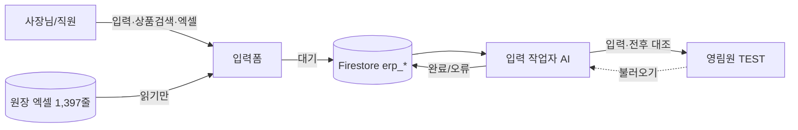
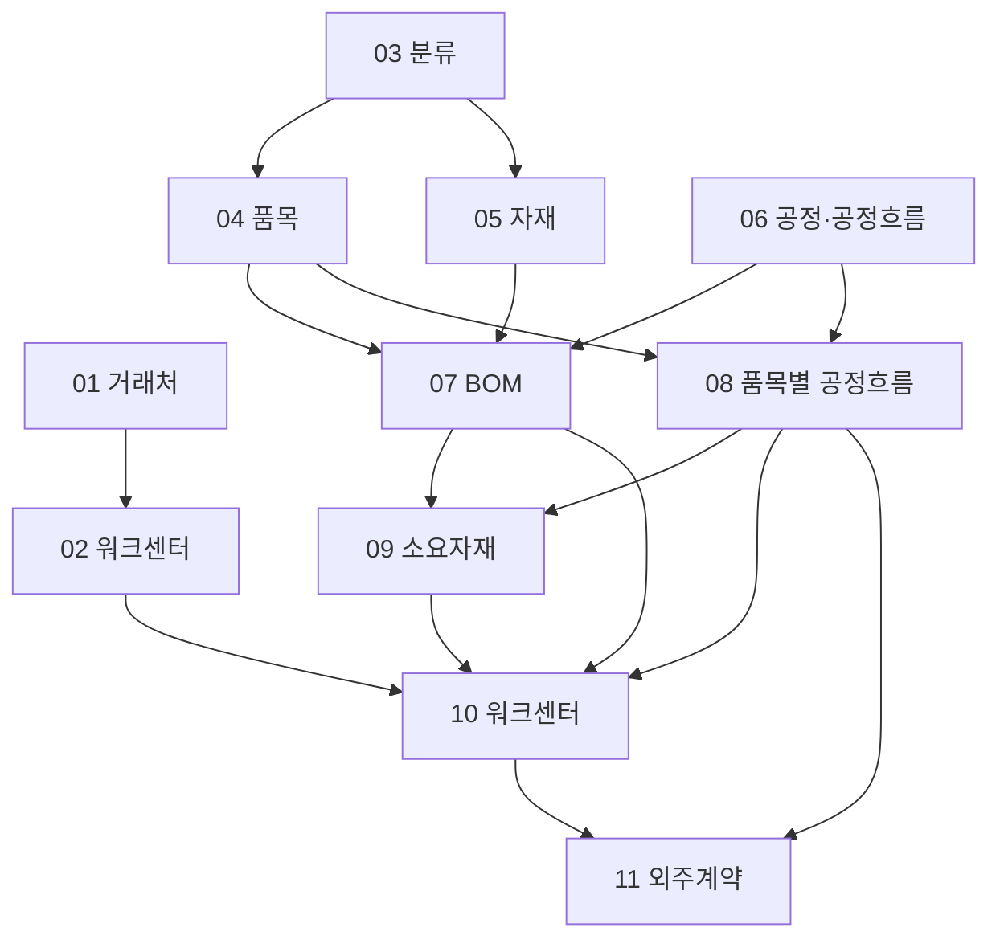

# 영림원 외주입력 — 홈

> [!abstract] 한 줄 요약
> 사람이 단계별 입력폼에 자료를 쌓아 두면(**대기**) → AI 입력 작업자가 그 대기 건만 영림원 화면에 옮기고 → 결과를 폼에 되돌려 적는(**완료/오류**) 구조. 폼은 원장 엑셀에서 부속·공정·BOM을 최대한 자동으로 펴 준다.

> [!tip] 이 볼트 쓰는 법
> 그래프 보기(Graph view)를 열면 단계↔논리 연결이 보입니다. 단계 노트 아래쪽의 **백링크**에서 '이 단계를 쓰는 논리'를 찾으세요. 큰 그림은 [[영림원외주입력.canvas|캔버스]].



## 11단계

1. [[01 거래처]] — 거래처 1건
2. [[02 워크센터]] — 워크센터 1건
3. [[03 분류]] — **소분류 1줄**
4. [[04 품목]] — 품목 1건
5. [[05 자재]] — 자재 1건
6. [[06 공정·공정흐름]] — 흐름 1건 + rows(공정 순서)
7. [[07 BOM]] — 모품목 1건 + rows
8. [[08 품목별 공정흐름]] — **품목+흐름 한 줄**
9. [[09 제품별공정별소요자재]] — 품목+공정차수 1건
10. [[10 제품별공정별워크센터]] — **품목+공정+워크센터 한 줄**
11. [[11 외주계약]] — 외주거래처 1건 + rows

(Dataview 플러그인을 쓰면 아래 표가 자동으로 그려집니다. 없어도 위 목록으로 충분합니다.)

```dataview
TABLE 단계, 컬렉션, 영림원화면
FROM #영림원/단계
SORT 단계 ASC
```

## 업무 기준
- [[업체 규칙 WC_RULE]] · [[공통부속 7항목]] · [[이름 규칙]] · [[분류 규칙]]

## 자동화 논리
- [[상품검색 공용 부품]] · [[원장 부속코드 to 공정흐름]] · [[BOM 소요량 계산]] · [[엣지필름 소요량]]
- [[빈 흐름 막기]] · [[미등록 안내]] · [[분류 수정 나무]] · [[제품 등록 점검표]] · [[엑셀·구글시트 양식]]

## 운영
- [[상태 흐름]] · [[작업자 프로토콜]] · [[안전장치]]
- [[진행 상황]] · [[미결 사항]] · [[용어]]

## 어디서 왔나
- 저장소 `영림원외주입력/`: `CLAUDE.md`(버전별 변경·함정) · `입력작업자/AGENTS.md`(작업 순서) · `사장님-규칙.md` · `화면별-요령.md` · `작업일지.md` · `erp-spec.json`
- 이 볼트는 위를 읽고 정리한 요약입니다. **다 읽지 못한 것:** 폼 본문(약 370KB) · `화면별-요령.md`(약 137KB) · `스크립트/*.js`. 사장님 말씀과 다르면 말씀이 맞습니다.
- 공개 저장소이므로 사업자번호·단가·원장 엑셀 같은 실제 거래 자료는 넣지 않았습니다.
