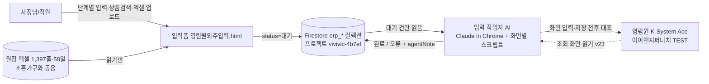
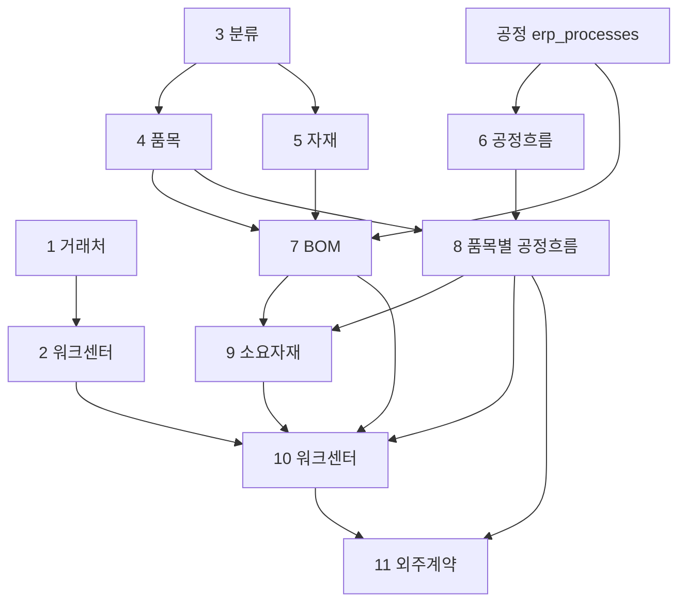
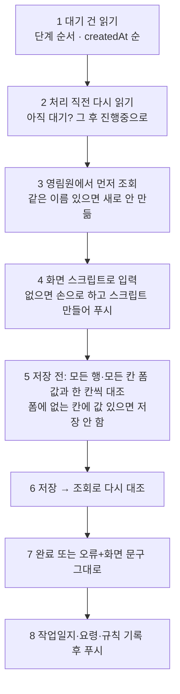

# 영림원 외주입력 — 지금까지 만든 논리 정리

> [!abstract] 한 줄 요약
> 영림원 ERP 테스트서버에 생산외주 자료를 넣기 전에, **사람이 단계별 입력폼에 자료를 쌓아 두고(대기)** → **AI 입력 작업자가 그 대기 건만 영림원 화면에 옮겨 넣고** → 결과를 폼에 되돌려 적는(완료/오류) 구조. 폼은 "원장(조혼가구와 같은 원장 엑셀)에서 부속·공정·BOM을 최대한 자동으로 펴 주는" 쪽으로 발전해 왔다.

> [!info] 이 노트의 근거와 한계
> - 읽은 것: `영림원외주입력/CLAUDE.md`(폼 v2~v64 변경 기록), `입력작업자/AGENTS.md`(작업 순서), `입력작업자/사장님-규칙.md`, `입력작업자/작업일지.md`(앞부분), `공통부속분석/요약.md`.
> - 코드로 직접 대조한 것: `WC_RULE`, `bomCalc`, `edgeInfo`, `ifAutoPart`, `iwClue`, `iwCheck`, `imSupply`, `imErr`, `verPad`, `flowGap`, 판 번호(v64). 문서 설명과 일치함.
> - **다 읽지 못한 것**: `영림원외주입력.html` 전체(약 370KB), `화면별-요령.md`(약 137KB), `스크립트/*.js` 본문. 영림원 화면 칸 단위 사실은 이 노트에 거의 안 넣었다 → 필요하면 `화면별-요령.md` 참조.
> - 사장님 말씀과 이 노트가 다르면 **말씀이 맞다** (저장소 규칙과 같음).

## 목차
1. [[#1. 전체 구조]]
2. [[#2. 업무 기준 (사장님이 정한 것)]]
3. [[#3. 11단계와 데이터 모델]]
4. [[#4. 핵심 자동화 논리]]
5. [[#5. 입력폼 공통 기능]]
6. [[#6. 입력 작업자 프로토콜]]
7. [[#7. 안전장치와 일하는 규칙]]
8. [[#8. 현재 진행 상황]]
9. [[#9. 미결·확인 못 한 것]]

---

## 1. 전체 구조



- **폼**: `영림원외주입력.html` 한 장. 파이어베이스 익명 로그인. 영림원에는 직접 못 닿는다.
- **저장소**: `erp_` 로 시작하는 컬렉션만 쓴다(기존 업무 컬렉션은 안 건드림).
- **작업자**: AI든 사람이든 `입력작업자/AGENTS.md`부터 읽고 같은 순서로 일한다.
- **목표(사장님)**: "말로 시켜서 AI가 등록하게 하는 것"이 아니라 **"폼을 통해 AI가 등록하게 만드는 것"**. 그래서 채팅 지시로 직접 등록하지 않고 폼 대기 건만 처리한다.
- **테스트 서버**에 먼저 입력해 보면서 논리를 찾는 단계다. 기존 영림원 자료(알렉스 제품 162개 부속, 원자재, 기존 엣지필름 등)는 **쓰지 않고**, 이름 앞에 `T`를 붙여 새로 등록한다.

---

## 2. 업무 기준 (사장님이 정한 것)

### 2-1. 공정과 업체 (`WC_RULE`, 11-04 기준)

공정 = **재단 · 엣지 · 보링 · 조립** (+ NC, 곡면엣지, 포장 등 흐름에 나오는 것들)

| 공정 | 맡을 수 있는 업체 |
|---|---|
| 재단 | AMT · 경기산업(=경기재단) · 조혼가구 |
| 엣지 | 이룸산업 · 조혼가구 · AMT |
| 보링 | 로앤디자인 · 조혼가구 · AMT *(AMT는 11-04에 추가)* |
| 조립 | AMT · 조혼가구 · 아인가구 · 진아산업 · 럭스디자인 |
| NC | AMT · 조혼가구 · 진아산업 |

- 규칙 표에 없는 공정(곡면엣지·멤브레인·포장)은 등록된 워크센터 전부 중에서 고른다.
- 실제 업체는 8곳: AMT·경기산업·조혼가구·이룸산업·로앤디자인·아인가구·진아산업·럭스디자인. (이룸산업·로앤디자인은 실제로는 한 회사지만 정산은 따로.)
- **공정마다 기본 업체를 두되, 주문마다 바꿀 수 있어야 한다.** 같은 제품이면 업체가 달라도 단가는 같다.
- 표를 바꾸면 폼의 `WC_RULE`과 `사장님-규칙.md`를 같이 고친다.

### 2-2. 공통부속 판정 (7항목)

> **원장명 · 마감 · 마감색상 · 재단W · 재단D · W엣지면 · D엣지면** 이 모두 같으면 같은 부속. (부속명·제품·시리즈는 안 봄)

- 같은 부속은 품목 **하나**로 만들어 여러 제품 BOM에서 나눠 쓴다.
- 원장 1,397줄 분석: 서로 다른 부속 **680** = 공통 **290** + 단독 **390**. (재단W·D가 빈 칸이라 억지로 묶인 공통부속이 6개 있음.)
- 영림원 품목등록에는 "공통부속" 표시 칸이 **없다** → 같은 품번이 여러 BOM에 들어가는 것으로만 드러난다. 그래서 **부속 정보 어딘가에 공통부속 단서(7항목 키, 묶음 번호, 쓰는 제품 목록 등)를 갖고 있어야 한다**는 것이 사장님 지시(11-01). 칸·꼴은 **미정**. ([[#9. 미결·확인 못 한 것]])

### 2-3. 부속의 공정 판단

원장의 `재단부속코드 · 엣지부속코드 · 보링부속코드 · NC부속코드 · 조립부속코드` 칸에 **값이 있으면 그 공정을 거친다**. 작업이 없는 부속은 그 코드가 비어 있다.

### 2-4. 이름 규칙

- 테스트 자료는 이름 앞에 `T` (T에이엠티, T조혼가구, T재단 …). 기존 자료는 건드리지 않는다.
- 제품 품명 = `T` + 원장 단품명 **글자 그대로** (예: `T(KRW) 알렉스 800 높은 수납장 올화이트`). "(KRW)"를 떼면 다른 프로그램에서 검색이 안 된다 — 다듬는 식을 다시 넣지 말 것.
- 흐름 이름 = 공정명을 `-`로 이은 것 (예: `T재단-T엣지-T보링`). **공정 이름에는 `-` 금지.**
- T워크센터의 창고 6종은 모두 **그 워크센터와 같은 이름의 창고**. 업체 간 이동은 자재이동으로.

### 2-5. 분류(대·중·소)

| 품목구분 | 대분류 | 중분류 | 소분류 | 예 |
|---|---|---|---|---|
| 제상품 | 공간 | 제품 종류 | 상품색상 | `T리빙룸 > T수납장 > T올화이트` |
| 자재(보드) | 보드 | 그 자재의 **마감** | 그 마감 자재 **거래처의 제품코드** | `T보드 > T엘피엠 > T201양면` |

- "올화이트" 같은 **상품색상은 제품에만** 있는 속성. 부속 이름의 색은 마감색상(화이트).
- 폼 문서의 품목·자재 `small`은 `대 > 중 > 소` **경로**로 저장하고, 영림원 소분류 이름은 `대_중_소`(`_` 이어붙임) 꼴이다. 두 꼴을 `clsName`/`clsFind`가 서로 찾아 준다.
- 엣지필름 자재 = **자재 중분류가 `T엣지필름`** 인 것 (이름이 아니라 분류로 판단).

### 2-6. 엣지필름 소요량

> 부속당 **((재단W × W엣지면 + 재단D × D엣지면) ÷ 1000 + 0.04) × 1.02** M

- 0.04(40mm)는 면마다가 아니라 **부속당 한 번**, 1.02는 여유분 2%. 예: 도어 784×396, 2면씩 → 2.36 → **2.448 M**.
- 필름은 **매입해서 가공업체에 보내 주는 것** → 자재 등록 + BOM의 `T엣지` 줄로 재고·소요량을 잡는다. 엣지 가공비는 나중에 외주계약 단가.
- **부속마다 쓰는 필름이 다를 수 있다.** 어느 부속에 어느 필름이라는 자동 규칙은 *일부러 없다*(사람이 고른다).

---

## 3. 11단계와 데이터 모델

### 3-1. 단계와 컬렉션

| # | 단계 | 컬렉션 | 영림원 화면 | 한 문서의 단위 |
|---|---|---|---|---|
| 1 | 거래처 | `erp_vendors` | 거래처등록 | 거래처 1 |
| 2 | 워크센터 | `erp_workcenters` | 워크센터등록(500226) | 워크센터 1 |
| 3 | 분류 | `erp_classes` | 품목대중소분류정의(502365) | **소분류 1줄**(대·중 이름은 문서마다 겹침) |
| 4 | 품목 | `erp_items` | 품목등록(500215) | 품목 1 |
| 5 | 자재 | `erp_materials` | 자재등록(500251) | 자재 1 |
| 6 | 공정·공정흐름 | `erp_flows` (+`erp_processes`) | 공정등록 / 공정흐름유형등록(500228) | 흐름 1 + `rows`(공정 순서) |
| 7 | BOM | `erp_boms` | BOM등록업로드(500302) 엑셀 일괄 | 모품목 1 + `rows`(하위 줄) |
| 8 | 품목별 공정흐름 | `erp_itemflows` | 품목별공정흐름유형등록(500272) | **품목 + 흐름 한 줄** |
| 9 | 제품별공정별소요자재 | `erp_itemmats` | 소요자재등록(500299) / 일괄등록(525162) | 품목 + 공정차수 1 |
| 10 | 제품별공정별워크센터 | `erp_itemwcs` | 제품별공정별워크센터등록(500865) | **품목 + 공정 + 워크센터 한 줄** |
| 11 | 외주계약 | `erp_contracts` | 외주계약등록 | 외주거래처 + `rows` |
| — | 영림원에서 불러오기 | `erp_imports` | 각종 조회 화면 | 요청 1 |
| — | 제품 등록 점검표 | (저장 안 함) | — | 가상 화면 |

> [!note] 번호 이력
> 처음엔 6단계였고(거래처→워크센터→품목→공정→BOM→외주계약), 분류·자재(v25), 흐름(v19/v20), 품목별 흐름(v48), 소요자재(v57), 워크센터(v55→v57에서 10번으로)가 끼면서 11단계가 됐다. 문서에 "9 워크센터·10 외주계약"으로 적힌 옛 절은 지금 번호와 다르다.

### 3-2. 의존 관계 (앞 단계가 뒤 단계의 재료)



- 앞 단계에 대기·수정대기·오류가 남아 있으면 뒤 단계는 건너뛰고 `agentNote`에 이유를 적는다(영림원에 이미 있는 자료는 예외).
- 같은 단계 안에서는 `createdAt` 오름차순 = 처리 순서. (소요자재는 **부속 먼저, 제품 나중**.)

### 3-3. 문서 공통 필드와 상태

```
status: 대기 → 진행중 → 완료 | 오류
수정:   완료 → 수정대기 → 진행중 → 완료 | 오류
공통:   agentNote(작업자 메모·화면 오류 문구 그대로) · createdAt · route(ERP 메뉴 경로)
출처:   source='영림원'(불러온 것) · ylwDiff(영림원과 다른 점) · ylwCode(영림원 코드)
```

- ⚠ 칸 키에 `status · agentNote · createdAt · route · rows`를 쓰지 말 것. (v25: 품목상태 키를 `status`로 두었다가 처리 상태와 겹쳐 값이 "대기"로 덮인 버그.)
- 열쇠(중복 판정): 거래처·워크센터·공정·흐름=이름 / 품목=품번 / BOM=모품목번호+차수 / 품목별흐름=품번+흐름 / 소요자재=품번+공정차수 / 워크센터=품번+차수+순서+공정+워크센터 / 외주계약=외주거래처.
- 오류 건은 중복 검사에서 제외한다.

---

## 4. 핵심 자동화 논리

모든 자동 값은 **"처음 값"일 뿐**이다. 사람이 고르면 덮어쓰지 않고, 저장은 사람이 누른다.

### 4-1. 상품검색 → 제품 + 부속 펼치기 (공용 부품)

- 조혼가구 프로그램의 "제품 발주 상품검색"을 **베끼지 않고 공용 부품으로 연결**: `shared/발주상품검색.js`(검색·고르기 논리) + `shared/발주상품고르기.html`(iframe, 조혼가구와 같은 모양). 한 곳을 고치면 둘 다 바뀐다.
- 검색 방법 셋: **상품검색 · ING단품명 · 카테고리**(대→중→소→색상, 선택지가 하나면 자동으로 넘어감).
- 제품을 고르면 원장에서 그 제품의 부속 줄들을 가져오고, 7항목 키로 묶어 **공통부속은 한 번만**, 같은 부속이 여러 번 쓰이면 세트별소모량을 합산(상판1+지판1=2).
- 사용처: 4 품목 품명, 7 BOM 모품목, 8·9·10단계 줄 펴기, 점검표.

### 4-2. 원장 부속코드 → 공정흐름 자동 (8단계)

```
부속의 공정 = 재단 → 엣지 → 보링 → NC 중 코드가 있는 것만 순서대로
흐름 이름   = 위 공정을 '-'로 이음   예) T재단-T엣지-T보링
제품 줄     = 조립부속코드가 있으면 T조립
```

- 6단계에 그 이름이 있으면 드롭다운 처음 값으로, 없으면 비우고 "등록되지 않은 조합: …" 안내 + 6단계로 보내 이름·공정 칸을 채워 준다.
- 같은 부속인데 원장 줄마다 코드가 달라 조합이 갈리면 **비우고** 이유를 적는다(짐작 금지).
- 화면에는 코드가 아니라 **"원장 공정: 재단 엣지 보링 / 없음 / —(제품)"** 명칭으로만 보여 준다(확인용, 문서에도 영림원에도 안 감).
- 알렉스 부속 14개 결과: p01·p02 = 재단-엣지, p03~p10 = 재단-엣지-보링, p11~p14 = 재단.
- 원장 전체 조합: 재단 203 · 재단엣지 393 · 재단엣지보링 752 · 재단보링 9 · 재단엣지보링NC 12 · 코드 없음 28줄.
- ⚠ **곡면엣지·멤브레인을 가리키는 코드 열은 원장에 없다** → `T재단-TNC-T곡면엣지` 같은 흐름은 자동으로 안 나온다(사람이 고름).
- 저장된 품번은 줄을 **표에서 빼고** "이미 저장 n건은 뺐습니다"로 알린다(중복 등록 방지). 한 품목에 흐름 둘 이상이면 "저장된 줄 보기 → 흐름 추가".
- **빈 흐름 막기**: 영림원은 상세 공정이 0줄인 흐름(T조립·T포장이 이 상태였음)의 품목별 공정흐름 저장을 거부한다. 폼은 그런 흐름을 "공정 없음"으로 보고 드롭다운에서 못 고르게 하고, 6단계 "공정 채우기"(수정대기)로 유도한다.

### 4-3. BOM (7단계)

**제품 BOM**: 모품목 = 제품, 하위 = 부속들
- 공정 `T조립` · 투입단위 EA · 소요량 = 합산한 세트별소모량 / 1 · BOM차수 `00`
- 하위가 **부속(4 품목 반제품)** 이면 하위BOM차수 `00` + 하위유무 켬 / 하위가 원장 자재면 차수 빈 칸 + 끔
- 4 품목과 이어 붙이는 임시 규칙(원장↔품목 연결 열쇠가 없어서): 제품은 이름(맨 앞 `T`·괄호 묶음 떼고 비교), 부속은 **규격 `W*D` 일치 + 품명 낱말 포함**, 그리고 **딱 하나일 때만** 이음. 못 이으면 빨간 줄 + 하위품번 직접 선택.

**부속 BOM** ("부속 BOM n개도 한꺼번에 만들기"): 모품목 = 부속, 하위 = 원장 자재, 공정 `T재단`, 소요량 **1 / n**
- 원장 자재는 원장 엑셀의 원장명(PB-18T 등) + 마감 + 마감색상이 **모두** 이름에 들어 있는 5단계 자재가 **딱 하나**일 때만 이음(아니면 비우고 "필수 빠짐").

**원장 1장에서 나오는 개수 n** (에이엠티 재단 편집기와 같은 공용 모듈 `shared/원장재단수량.js`):

```
n = ⌊(원장W − 5 + 4.5) ÷ (부속W + 4.5)⌋ × ⌊(원장D − 5 + 4.5) ÷ (부속D + 4.5)⌋
    (전단컷 5mm, 톱날 4.5mm, 바둑판 한 방향, 자투리 몫은 안 셈)
```
- **결방향 있음**(체크) → 부속을 돌리지 않음 / 없음 → 더 많이 앉는 쪽으로 돌림. 기본값은 원장 엑셀 결보호 칸(`X`·모름=끔, `O`·섞임=켬).
- 예: 784×396 on 2440×1220 → 3×3 = **9 → 1/9**, 백판넬 1172×758 → 돌리면 **1/3**, 결 그대로면 1/2.
- 규격에 원장 크기(`2440*1220`)가 없거나, 모품목 규격이 없으면 계산 안 함(노란 이유 줄). 사람이 고친 값은 덮지 않는다.
- 저장 문서의 `grain`(결방향)은 영림원에 안 보낸다(양식에 칸 없음).

**엣지필름 줄 추가**: 원장에 엣지부속코드가 있는 부속만 한 줄씩. 소요량은 [[#2-6. 엣지필름 소요량]] 식. 이미 완료된 BOM은 **수정대기**(`edit.added` = 더한 줄)로, 대기 BOM은 줄만 더한다. `T엣지` 공정은 BOM에 안 남고 9단계 투입공정 값이 된다.

**업로드 호환**:
- 영림원 BOM 일괄업로드(500302)의 실제 양식: 시트명 `BOM일괄업로드`, **1행=영어 칸 코드, 2행=한글 이름, 3행부터 자료**, 37열. 한글 머리 1줄짜리는 영림원이 줄로 못 읽는다 → 폼 양식을 이 꼴로 맞췄다(끝에 폼 전용 `FormGrain`).
- 하위유무(HaveChild)는 양식에 칸이 없어 **올린 뒤 표에서 켠다**.
- 한 파일에 모품목이 여럿이면 **모품목번호가 바뀔 때마다 새 BOM**으로 나눈다(`bomSplit`). 엑셀·CSV·구글시트·입력 칸 붙여넣기 모두 같은 길.
- 차수는 2자리 글자(`verPad`: `0`→`00`). 엑셀이 `00`을 숫자 0으로 바꾸는 문제 방어.
- (사고 기록) 18개 BOM이 38줄 한 문서로 합쳐져 들어온 건은 v43 이전 판 화면(탭을 열어 둔 채)에서 올린 것 → 저장 직전 **배포판 판 번호 확인**(`freshCheck`)으로 옛 판 저장을 막는다.

### 4-4. 소요자재 (9단계) — 사람 입력 없이 폼이 만든다

저장할 때 `imDoc`이 앞 단계에서 문서를 만든다:
- `procs` = 그 품목 흐름의 `rows`(공정 순서) / `mats` = BOM 하위 줄(투입공정·소요량·투입단위 그대로)
- **조달구분** `imSupply`: 5단계 자재면 **구매**, 4단계 품목(반제품)이면 **제작**(+반제품공정차수 = BOM 하위차수, 없으면 00)
- 막는 것(`imErr`): BOM 없음 / 8단계 흐름 없음 / 그 품목에 없는 흐름 / 공정 없는 흐름 / 하위가 4·5단계에 없음 / 투입공정이 흐름에 없음
- **저장 순서 부속 → 제품** (제품의 반제품공정차수가 부속 공정차수를 가리키므로)
- 영림원 일괄등록(525162) 결과의 한계: 공정은 흐름 공정 전부로 만들어지지만 **투입공정이 전부 "최종 공정"** 으로 들어간다 → 공정이 2개 이상인 부속만 500299에서 원장 줄 투입공정을 `T재단`으로 고쳐야 한다(공정 1개 품목·제품은 고칠 것 없음). 워크센터·시간단위는 빈칸, 표준작업시간 0 → 10단계에서.

### 4-5. 제품별공정별워크센터 (10단계)

- 줄의 공정 = `iwSteps` = 8단계 흐름 → 6단계 흐름 `rows`. 업체 후보 = 2단계 워크센터 중 `WC_RULE`이 허용하는 것.
- 한 공정에 업체 여럿: **업체 단추를 누른 순서가 우선순위(`rank`, 1=기본)**, 고른 업체마다 문서 하나. 숫자(흰 동그라미)로 보인다. 다시 누르면 빠지고 뒤 번호가 당겨짐.
- 의미: *단가를 계약해 맡길 가능성이 있는 업체는 모두 등록하고, 실제 업체는 발주 때 외주발주입력에서 고른다.*
- 처음 값 `iwClue`: 원장에 공정별 업체 칸이 **없다**. 단서는 `공급처`(AMT·외부발주·공통부속)뿐 → 부속 공급처가 모두 AMT면 AMT가 하는 공정(재단·엣지·NC·보링)에만 `T에이엠티`, 제품 조립은 `ing발주처`(조혼가구→T조혼), 나머지는 빈칸.
- 막는 것(`iwCheck`): 흐름 없음 / 흐름에 없는 공정 / 없는 워크센터 / `WC_RULE` 밖 조합.
- 외주계약에 꼭 필요: 외주계약등록 왼쪽 "등록대상공정건수" = 525145의 가공/업체 줄 수.

### 4-6. 분류 수정 = 나무로 퍼진다 (3단계 수정대기)

- 한 문서가 소분류 한 줄이라 대·중분류 이름은 여러 문서에 겹쳐 있다. 이름을 고치면 `clsPlan`이 영향 범위(하위 분류·품목·자재)를 계산하고 **한 트랜잭션**(`updateAll`)으로 같이 바꾼다.
- 고친 문서만 `수정대기`(영림원 입력 대상). 따라 바뀐 문서는 `editLog "따라 바뀜"`, 상태 그대로. 영림원에서는 대·중분류가 하나뿐이고 품목은 분류를 **코드**로 물고 있어 한 번만 고치면 된다.
- 같은 대·중 판정은 영림원 코드(`ylwCode`)가 있으면 코드로, 없으면 품목구분+이름으로.
- 막음: 같은 이름/경로가 이미 있음(합치기·옮기기 안 됨), 진행중·수정 중 문서가 섞임, 450건 초과.
- "수정 취소" = `edit.tree`로 함께 되돌림.

### 4-7. 앞 단계 미등록 안내 (v38) — 유도

상품검색으로 상품을 골랐는데 앞 단계가 안 돼 있으면 막지만 말고 **무엇을 어느 단계에서 등록해야 하는지 절차를 보여 주고**, "등록하기"를 누르면 그 단계로 가서 **값을 미리 채워 준다**(저장은 사람). 돌아오면 같은 상품을 다시 골라 이어진다.
- 상태 판정은 *폼 기록 기준*: 완료=영림원에 있음, 대기·진행중·수정대기=등록 중, 오류뿐/없음=미등록.
- 채우는 값 예: 제품 품명=`T`+원장 단품명, 부속 품명=`T + 시리즈 + 부속명 + W x D + 마감색상`, 규격 `W*D`, 소분류는 후보가 **하나일 때만**. **품번·기준단위는 비워 둔다.**

---

## 5. 입력폼 공통 기능

| 기능 | 요점 |
|---|---|
| 엑셀/구글시트 양식 | 단추는 "양식 다운로드"·"일괄 업로드" 둘, 누르면 로고로 엑셀/구글 선택. 열 이름은 영림원 화면 글자 그대로, 필수는 `*`, 열마다 설명 메모, 숨긴 "목록" 시트 + 드롭다운. 올리기는 모든 길이 `takeSheet` 한 함수. |
| 일괄 업로드 목록 | 여러 줄이면 업체(줄)마다 버튼 + 상태 칩(준비중/필수 빠짐/이름 겹침/번호 틀림/외주거래처 미등록/공정 확인 …). 버튼을 누르면 그 건이 입력 칸에 열리고, "모두 저장"은 준비중만 파일 순서대로. **덮어쓰지 않는다.** |
| 드롭다운 | 목록에서 고르는 칸은 모두 드롭다운(+필요하면 "직접 입력"). 정해진 목록 칸은 필수. 외주거래처처럼 등록된 것만 허용하는 칸은 "직접 입력" 없음. |
| 사업자번호 | 숫자 10자리, 저장은 `000-00-00000`. 외주가공·국내매입·국내매출 종류면 필수. 검증숫자 틀리면 경고만. |
| 사업자등록증 업로드 | PDF(글자층→pdf.js) / 사진·스캔(tesseract.js 한국어 OCR) — 브라우저 안에서만 읽음. |
| 수정 | 완료 건 "수정"→`수정대기`. 품번 잠금, 바뀐 칸만 `edit.before/after`로 기록, "수정 취소" 가능. 품목은 셀 표("완료 품목 불러오기")로 붙여넣기 일괄 수정도 됨. |
| 삭제 | 대기·오류만 선택 삭제/모두 삭제(트랜잭션으로 그 사이 진행중이 된 건은 남김). 진행중·완료·수정 중 건은 못 지움. |
| 저장한 항목 검색 | 품목·분류는 목록이 많아 **검색어가 있어야** 카드가 보임(수정 중인 폼은 항상 보임). |
| 영림원에서 불러오기(v23) | 단계마다 "건수 먼저 보기"/"불러오기 요청" → `erp_imports`. 폼에 **없는 것만** 넣고(완료·source 영림원), 있는데 다르면 `ylwDiff`만 적는다. 실제 운영 전 반드시 단계별로 해야 함. |
| 제품 등록 점검표 | 상품 하나를 고르면 품목·BOM·공정흐름·흐름 안 공정·소요자재·워크센터·(엣지필름) 상태를 O/✕/대기/오류로 보여 주고 ✕를 누르면 해당 단계로 이동. 저장 안 함. |
| 판 번호 | 파일 첫 줄 주석 `올린다: vNN`과 머리띠 배지를 같이 올림. 저장 직전 배포판과 비교해 옛 판이면 저장 막음. |

---

## 6. 입력 작업자 프로토콜



- **BOM**은 칸 붙여넣기가 아니라 500302 **엑셀 일괄업로드**로(`BOM업로드-엑셀만들기.py`, 업무 자료라 git 밖). 순서: 부속 1건 시험 → 대조 → 나머지 부속 → 제품 1건 → 제품.
- **수정대기**: 품번으로 조회 → 영림원 값이 `edit.before`와 같은지 확인(다르면 고치지 않고 오류) → 바뀐 칸만 수정 → 저장 전후 대조 → 완료 + `editLog`.
- **불러오기**: 열린 탭이라도 **조회를 다시** 한 뒤 읽는다(옛 표를 읽어 T조립을 놓친 적 있음). 큰 단계(품목 1,568, BOM 552)는 건수 먼저.
- 스크립트: `공통.js` → 화면별 `*-채우기.js`(채우고 저장 전 대조표까지, 저장은 안 누름) / `*-읽기.js`(불러오기용). 목록·쓰는 법은 `스크립트/README.md`.
- 크롬 탭: 새 탭은 로그인이 이어지지 않으니 **이미 로그인된 탭부터** 찾아 쓰고, 사장님이 보는 탭은 건드리지 않는다.

---

## 7. 안전장치와 일하는 규칙

> [!warning] 지금까지 사고가 낳은 규칙들
> 1. **실제 작동 화면을 직접 열어 확인한 뒤에만** 영림원에 맞춘다. 표는 오른쪽·아래 끝까지 밀어 모든 칸을 보고 칸 이름은 화면 글자 그대로. 못 본 건 "확인 못 함". *(사례: 워크센터 원가센터 칸을 기록만 보고 만들었다가 화면에 없어 v16에서 뺌)*
> 2. **저장 전·후 모든 칸(비고까지) 대조.** *(사례: 여러 줄 붙여넣기로 T이룸 행 비고에 다음 줄의 "T로앤"이 들어간 채 저장됨)*
> 3. **기존 자료를 고치거나 지우지 않는다.** 삭제·덮어쓰기·업로드는 사장님께 먼저. 예외는 폼 `수정대기` 문서의 바뀐 칸뿐.
> 4. **시키지 않은 건 하지 않는다**(코드 수정 시 요청 외 수정 금지). 한 단계가 끝나면 다음 지시까지 멈춘다.
> 5. **공개 저장소**: 비밀번호·계정·실제 거래 자료(사업자번호, 원장 엑셀, 단가) 커밋 금지. 이름·코드·화면 사실만.
> 6. 메뉴 검색은 결과가 하나면 **바로 열린다** → 이어 친 글자가 엉뚱한 화면에 들어간 사고가 두 번(저장은 안 됨, 변경 0건 확인).

개발 쪽 습관:
- **시험은 진짜 파이어베이스로 나간다** → `connectDb`를 메모리 가짜로 바꾼 사본으로 시험하고 "진짜 쓰기 0"을 확인. (10-30에 시험 문서가 한 건 진짜 컬렉션에 쓰인 적 있음.)
- 시험은 **모든 줄이 기대값인지** 봐야 한다(값이 있는 줄만 모아 비교하면 빈 줄 버그를 놓침 — v50).
- 외부에서 온 값은 `textContent`/DOM으로만 그린다. `append`/`replaceChildren`에 `null`을 주면 화면에 "null"이 찍힌다.
- 상품검색 iframe을 쓰는 새 단계는 `fn.opening` 막음을 달 것(틀이 다시 뜨며 오는 "풀림" 알림이 표를 지움).
- 폼 `STEPS`/`ROUTES`를 고치면 `erp-spec.json`(에이전트가 읽는 규격)을 다시 뽑는다.

---

## 8. 현재 진행 상황 (2026-11-04 기준)

| 단계 | 영림원 반영 상태 |
|---|---|
| 거래처·워크센터·공정·흐름·분류·품목·자재 | 테스트 자료(T…) 등록 진행됨. 11-04 자재 분류 `T재공품>T재공품>T재공품`(2006007/2005022/2004068) 등록 완료 |
| 7 BOM | 제품 4 + 부속 14 = **18건 모두 완료**. 엣지부속 10건 모두 필름 줄 있음(필름 줄은 BOM 수정대기 6건+4건으로 추가) |
| 9 소요자재 | **18건 모두 완료**(부속 12 → 제품 4). 워크센터·시간단위는 빈칸 |
| 10 워크센터 | 대기 85건(18품목·36공정·업체 5곳). T-al-p11 T재단 3줄, T-al-p01 T엣지 2줄만 저장·대조 완료. **그 외 중간 공정은 저장 막혀 멈춤** |
| 11 외주계약 | 폼 단계는 있으나 단가 입력/입력 방식 미확정 |

테스트 제품: 알렉스 1200 높은 / 1200 더 높은 / 800 높은 / 800 더 높은 수납장 올화이트. 공통 부속(가와·도어·상지판·이동선반류)이 제품끼리 겹친다. 부속 공정: 백판넬=재단만, 이동선반류=재단·엣지, 나머지=재단·엣지·보링.

---

## 9. 미결·확인 못 한 것

### 사장님 결정이 필요한 것
- [ ] **중간 공정의 "공정품"** — 공정 2개 이상 품목의 중간 공정은 사외외주면 공정품이 필수라 저장이 막힌다. 영림원 일괄등록은 공정품을 최종 공정 줄에만 넣음. 무엇을 넣을지 결정 전에는 더 못 진행(10단계 워크센터).
- [ ] **공정별 재고(재공품)** — "공정별 재고가 정확해야 한다." 공정품일괄생성(523268)·재공재고조회(501186)를 찾았으나 500228의 숨은 칸 "공정품일괄생성대상"이 모두 꺼져 대상 0줄, 켜는 길 미확인.
- [ ] **공통부속 단서를 어느 칸·어떤 꼴로 둘지** (품번 규칙 / 폼 전용 칸 / 영림원 품목기타분류·추가정보).
- [ ] 원장↔품목 **영구 연결 열쇠** 저장 여부(지금은 이름+규격 임시 규칙). 제품은 원장 ing단품명, 부속은 7항목 키를 4 품목 문서에 저장하면 공통부속 단서와 한 번에 해결된다(제안만, 안 만듦).
- [ ] **외주계약(11단계) 구조** — 10-31 대화에서 "사람은 제품×공정 단가와 공정별 담당 업체표만 입력하고, 에이전트가 단가×업체로 계약 행을 펴서 넣는" 구조를 제안했으나 확정되지 않았다. 현재 폼은 업체를 먼저 고르고 단가를 입력하는 방식(같은 단가를 업체마다 반복).
- [ ] 이미 완료된 엣지 BOM 10건의 소요량은 **v62 이전 옛 계산식 값** (사장님이 "옛 값 그대로" 결정). 새 식으로 바꾸려면 BOM 수정 길을 따로 만들어야 한다.
- [ ] 영림원에 직접 넣은 자료(T우정 등)와 옛 규칙으로 만든 대분류 `T수납장(2003015)`·옛 자재 분류 `T원자재>T판재>T화이트` 처리.

### 기술적으로 확인 못 한 것
- 영림원이 BOM의 **하위BOM차수 00 + 하위유무**로 부속 BOM을 실제로 잇는지.
- 영림원에서 **분류명을 고쳐 저장**할 수 있는지, 이어 붙인 하위 이름이 따라 바뀌는지.
- 거래처상태·신용등급·사업단위·생산부서·정산기준·통화 등 드롭다운의 **전체 선택지**(폼은 직접 입력으로 열어 둠), 각 화면의 저장 오류 문구.
- 소요자재 일괄등록이 공정을 어디서 채우는지, 공정 여러 개 품목의 모든 경우.
- 곡면엣지·멤브레인 공정을 원장 코드로 식별하는 방법(없음).

### 알려진 한계
- **구글시트 양식은 고정 파일**이라 목록(공정·업체·품번 등)이 저절로 안 는다. BOM 구글시트 양식은 v47 새 꼴이 아직 안 올라가 옛 꼴. 엑셀 양식은 받는 순간 최신 목록. (사장님은 엑셀 저장이 안 돼서 구글시트 양식이 필수 — 새 단계를 만들면 구글시트 양식도 같이.)
- 부속 이어 붙이기는 이름·규격이 우연히 같은 다른 부속(색·두께·엣지가 다른 것)을 가리지 못한다.
- 폼 대기 77건·오류 3건이 11-04 재공품 조사 시점에 남아 있었다(현재 값은 확인 못 함).

---

## 부록: 어디를 보면 되나

| 알고 싶은 것 | 파일 (저장소 `영림원외주입력/` 기준) |
|---|---|
| 폼이 하는 일·버전별 변경·함정 | `CLAUDE.md` |
| 작업자 순서 | `입력작업자/AGENTS.md` |
| 사장님 규칙 원문 | `입력작업자/사장님-규칙.md` |
| 영림원 화면별 칸·요령 | `입력작업자/화면별-요령.md` |
| 날짜별 작업 기록 | `입력작업자/작업일지.md` |
| 화면 채우기/읽기 스크립트 | `입력작업자/스크립트/README.md` |
| 에이전트용 규격(메뉴경로·칸 대응·필수) | `erp-spec.json` |
| 공통부속 분석 | `공통부속분석/요약.md` (CSV는 공개 저장소라 미커밋, `분석.py`로 재생성) |
| 상품검색·재단수량 공용 부품 | `shared/발주상품검색.js` · `shared/발주상품고르기.*` · `shared/원장재단수량.js` |
