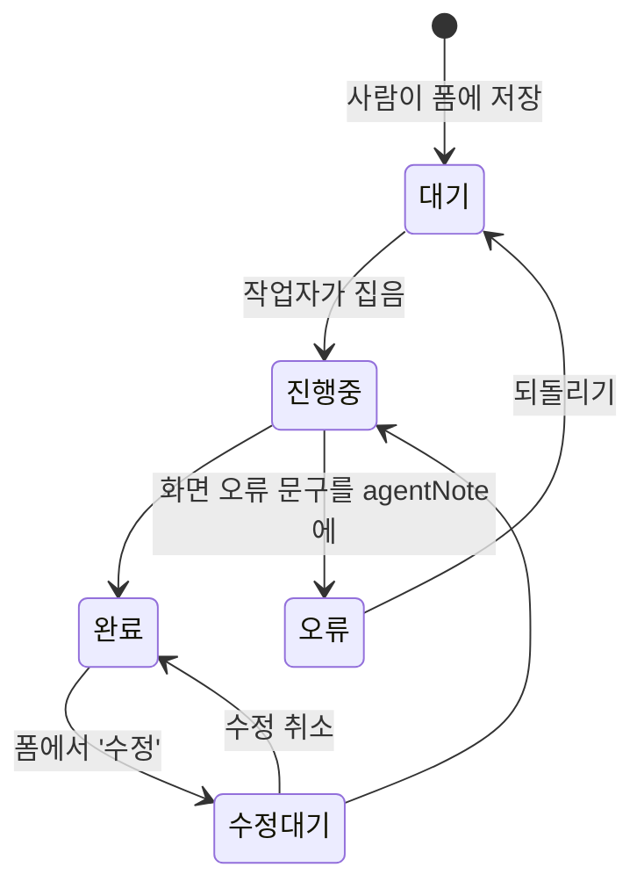

# 상태 흐름

공통 필드: `status` · `agentNote`(작업자 메모·화면 오류 문구 그대로) · `createdAt` · `route`(ERP 메뉴 경로)
출처 필드: `source='영림원'`(불러온 것) · `ylwDiff`(영림원과 다른 점) · `ylwCode`(영림원 코드)
수정: `edit.before/after/changed`, `editLog`

- 대기·오류만 삭제 가능(트랜잭션으로 그 사이 진행중이 되면 남김). 진행중·완료·수정 중은 못 지운다.
- 오류 건은 중복 검사에서 제외.
- 중복 열쇠: 거래처·워크센터·공정·흐름=이름 / 품목=품번 / BOM=모품목번호+차수 / 품목별흐름=품번+흐름 / 소요자재=품번+공정차수 / 워크센터=품번+차수+순서+공정+워크센터 / 외주계약=외주거래처.
- ⚠ 칸 키에 `status`를 쓰면 처리 상태와 겹친다(v25 품목상태 버그).

상위: [[00 홈]] · 관련: [[작업자 프로토콜]] · [[분류 수정 나무]]
