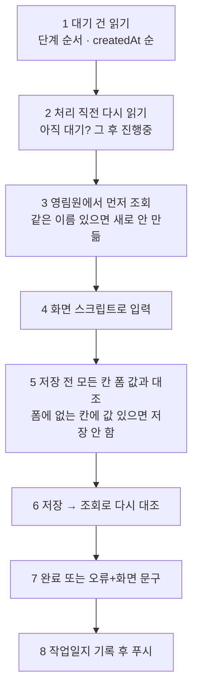

# 작업자 프로토콜

폼에 쌓인 **대기 건만** 영림원에 옮긴다. 채팅 지시로 직접 등록하지 않는다(목표: 말로 시켜 등록하는 게 아니라 **폼을 통해 AI가 등록**).

- 앞 단계에 대기·수정대기·오류가 남아 있으면 뒤 단계는 건너뛰고 이유를 `agentNote`에. 같은 단계는 `createdAt` 순.
- **BOM**은 칸 붙여넣기가 아니라 500302 엑셀 일괄업로드. 순서: 부속 1건 시험 → 대조 → 나머지 부속 → 제품 1건 → 제품.
- **수정대기**: 품번 조회 → 영림원 값이 `edit.before`와 같은지 확인(다르면 오류) → 바뀐 칸만 수정 → 전후 대조 → 완료.
- **불러오기**: 열린 탭이라도 조회를 다시 한 뒤 읽는다. 큰 단계(품목 1,568 · BOM 552)는 건수 먼저.
- 크롬: 이미 로그인된 탭부터 찾고 사장님이 보는 탭은 건드리지 않는다.

상위: [[00 홈]] · [[안전장치]] · [[상태 흐름]]
